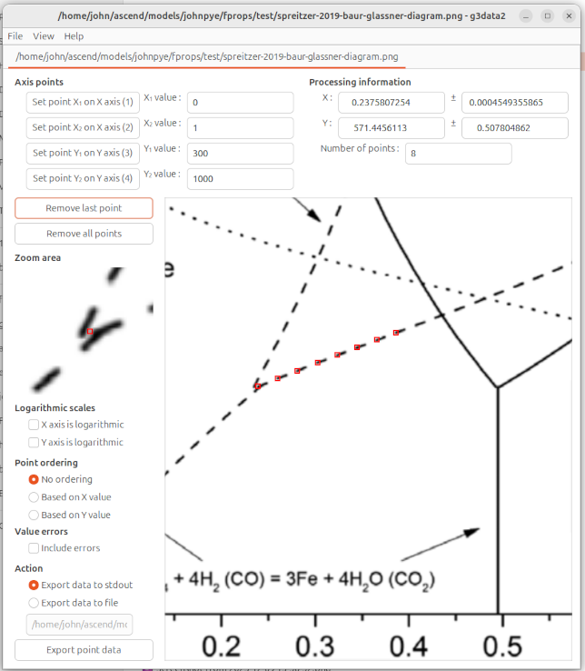

# What is g3data2?



g3data2 is a tool for extracting data from scanned graphs. For graphs published in scientific articles the actual data is often not
explicitly given; g3data makes the process of extracting this data fairly easy and fairly accurate.

Original 'g3data' source (GTK2 version): http://github.com/pn2200/g3data/
Fork 'g3data2' for GTK3: https://github.com/jonasfrantz/g3data2
New fork, same terrible name: https://github.com/jdpipe/g3data2

# Building from source

Install the GTK3 and SQLite development packages for your distro, as well as
SCons (www.scons.org). Then run `scons` to build the tool. CUnit is optional;
when available, `scons test` builds and runs the datastore, model, image-loading,
and perspective-correction tests. Image format support comes from the installed
GdkPixbuf loaders; additional formats such as WebP may require a loader package
provided by your distro.

On Ubuntu 24.04, this would be

```sh
sudo apt install libgtk-3-dev libsqlite3-dev libcunit1-dev scons
git clone https://github.com/jdpipe/g3data2.git
cd g3data2
scons
./g3data2
```

# Using the program

It's fairly self-explanatory. But to be explicit:

* open PNG images or any format supported by the installed GdkPixbuf loaders, such as JPEG, GIF, TIFF, BMP, and WebP (when its loader is installed). Non-PNG images honour embedded orientation. Animated and multi-page files open as a single still image; there are no frame/page selection controls.
* for a photograph taken off-axis, choose **View → Perspective correction…**. The left pane guides you through the **top-left, top-right, bottom-right, bottom-left** corners of a plot border or grid rectangle, in the order they should appear in the upright view. Pick on the original image, using the usual zoom and positioning aids. Click a corner button to replace it, **Start over** to clear the draft, **Cancel** (or Escape) to discard it, or **Apply** to return to calibration and sampling on the corrected view. Invalid or crossed corner selections cannot be applied.
* **View → Use perspective correction** switches the saved correction off and on. Corners and the enabled state are saved per image and support undo/redo. Calibration markers and sampled points always keep their original-image coordinates; changing the correction recalculates their displayed positions and graph values. The corrected bitmap retains the image margins and uses the canvas background outside its transformed outline. Correction is rendered before zooming and cached between zooms and toggles, with a limit of roughly 32 million pixels and 16,000 pixels per side. High zoom magnifies that cache, so it may reveal interpolation blur; the rendering limit does not change stored coordinates or calculated values. This corrects planar perspective, not curved lens distortion; selecting additional grid points for lens correction is a future refinement.
* a new or partially calibrated image starts a guided axis workflow in the left pane. Pick X1, X2, Y1, and Y2 on the image and enter each axis value. You can choose **Sample data instead** and return to calibration later; raw sampled points do not require a completed calibration.
* next you click points in the graph, amassing a list of points that can be copied to the clipboard, output to stdout, or written to a `.dat` file chosen through a save dialog. The **File** menu can also open the current image in the system's default image viewer, and exports the current or all series to stdout or a file; the **Edit** menu copies either scope to the clipboard. Point ordering and inclusion of error columns are persistent options grouped beneath the File export actions.
* sampled points are kept as double-precision image pixel coordinates. Data coordinates are recalculated from the current axis calibration whenever they are displayed or exported.
* once all four axis references and values are set, hold **Alt for about 300 ms** over the image to show the **axis reader**. It draws skew-aware guides from the cursor to both calibrated axes and shows the current X/Y values in a yellow label, without clicking or storing a point. The readout also works with perspective correction enabled. **View** → **Show uncertainty** adds the calculated uncertainty to that label. Releasing Alt hides the reader; pressing another key while Alt is held suppresses it, so menu shortcuts such as Alt+F behave normally. The reader is hidden while editing perspective corners.
* **View** → **Show positioning circle** adds a translucent black circle with white inner and outer edging at the image cursor. Ctrl+. enlarges the circle and Ctrl+, shrinks it in half-source-pixel diameter steps; the same actions are available in the View menu. In a perspective-corrected view, the guide stays circular and uses the local pixel scale at the centre of the selected rectangle for both its diameter and adjustment steps. Its size follows zoom but stays constant as the cursor moves. Diameter is remembered per image with its calibration, while visibility is remembered as an application preference.
* each image can have several named, coloured series. The five-row series list shows colour, label, point count, and visibility. Select the active series, use `+` to add one, and double-click or press Enter/F2 to rename. Right-click a series to delete it.
* a normal image click adds a point. Shift-click toggles a point in the active-series selection; Shift-drag selects several points with a marquee. Drag an already selected marker to move it. The **Edit** menu clears the current series or deletes the selected point(s); Delete and Backspace also delete the selection while the image has focus. Inactive visible series remain on screen in muted colours.
* content changes are immediately persistent and have a per-tab, memory-only undo/redo history. **Edit** → **Undo** (Ctrl+Z) and **Redo** (Ctrl+Shift+Z) cover point, series, calibration, and applied perspective-correction changes, including switching correction off and on. Closing the tab discards the history but retains its current state in SQLite. Export preferences and zoom/pan are not undoable.
* images initially use **Zoom to fit**. This remains active across window resizing and maximising until you manually zoom or pan, or choose another zoom level. You can zoom using ctrl-wheel, pan up and down with the mouse wheel, and pan left and right with shift-wheel. Smaller images can be enlarged to 16×; the maximum is reduced automatically for large images to keep the scrollable canvas within a safe size.
* zooming in is a good idea when selecting points. g3data2 has sub-pixel precision for identifying and working with point data.
* calibration, series, sampled positions, and applied perspective settings are saved automatically in `~/.local/share/g3data2/g3data2.sqlite3`. Reopening the same image content restores them, even after the image file is renamed or moved.
* clipboard exports advertise the `text/tab-separated-values` format explicitly, so they paste directly into spreadsheet cells in applications such as LibreOffice Calc without being mistaken for Markdown. Plain UTF-8 text remains available as a fallback.
* g3data2 will remember your recent files, which is useful because you never get this stuff right first time.
* once you have your data file, consider using fityk to do the curve fitting! one you get used to it, it's very powerful!

# Recent changes

* Added guided four-corner perspective correction, with persistent on/off state, undo/redo, padded image rendering, and source-coordinate-preserving point editing and export
* Kept the positioning guide circular after perspective correction, with its diameter and half-pixel adjustment steps based on the local pixel scale at the rectangle centre
* Added GdkPixbuf loading for JPEG and other installed image formats, with embedded orientation and detailed loading errors; PNGs retain direct Cairo loading
* Added main-pane zoom for precise point selection, with automatic zoom-to-fit on window resizing and up to 16× magnification for smaller images
* Switched sampled positions and coordinate calculations to double-precision arithmetic for sub-pixel accuracy
* Added automatic SQLite storage for calibration and named, coloured data series, restoring work even after an image is renamed or moved
* Added graphical point selection, marquee selection, movement, and deletion, plus series visibility controls
* Added per-tab, memory-only undo/redo for point, series, and calibration changes
* Reduced clicking during initial X1/X2/Y1/Y2 selection with a guided calibration workflow that advances to the next missing reference; sampling can also begin before calibration is complete
* Added an Alt-key axis reader for inspecting coordinates without storing points, with skew-aware guides, optional uncertainty display, and support for perspective-corrected views; an adjustable positioning circle helps align points with broad markers
* Added current-series and all-series export to files, stdout, and the clipboard, with persistent ordering/error-column options and spreadsheet-friendly tab-separated clipboard data
* Added a File menu action to open the current image in the system's default image viewer
* Added a SCons build script and optional CUnit tests covering storage, model operations, image loading, and perspective geometry, rendering, and pixel scale

# Roadmap

* Implement packaging for Ubuntu/elsewhere (help needed!)
* Portable project databases and database snapshots
* Ability to force orthogonality (eg when no rotation of the image is possible due to its provenance)
* Grid-based lens-distortion correction beyond the four-corner perspective workflow
* Implement smart curve tracing?

# License

g3data2 is distributed under the GNU General Public License (GPL), as
described in the 'COPYING' file.

John Pye, Feb 2026
